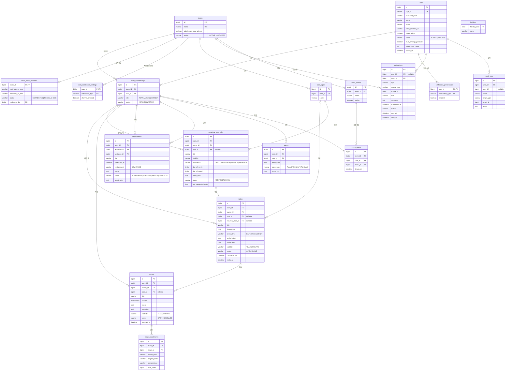

# ERD (초안 v0.1)

> 기준 문서: [PRD.md](PRD.md), [permissions.md](permissions.md), [features/](../features/)
> DB: MySQL 8 · 문자셋 `utf8mb4` · 접근: Spring Data JPA

## 1. 전체 다이어그램



> 다이어그램에서 `team_memberships ||--o{ todos`처럼 그린 관계는, 실제로는 `(team_id, owner_id)` → `team_memberships(team_id, user_id)` 복합 FK입니다. 아래 3.1 참고.

## 2. 공통 규칙

| 항목 | 규칙 |
|---|---|
| PK | `BIGINT AUTO_INCREMENT` |
| 공통 컬럼 | 모든 테이블에 `created_at`, `updated_at` (`DATETIME(6)`, JPA Auditing) |
| 시각 | `DATETIME(6)`, **UTC로 저장**. 화면 표시와 스케줄 계산은 `Asia/Seoul` |
| 날짜 | 기간, 연차, 공휴일처럼 "그날"을 뜻하는 값은 `DATE` (한국 날짜 기준) |
| Enum | `VARCHAR` + JPA `@Enumerated(EnumType.STRING)`. MySQL `ENUM` 타입은 쓰지 않음(값 추가 시 DDL 필요) |
| 삭제 | 사용자, 팀, 팀 소속은 **삭제하지 않고 상태만 변경**. 업무 데이터는 실제 삭제 |
| 마이그레이션 | Flyway (`backend/src/main/resources/db/migration`) |

## 3. 핵심 설계 결정

### 3.1 팀 데이터는 "팀 소속"을 통해 사람을 참조한다

팀 데이터(TODO, 이슈, 배포, 연차 등)는 `team_id`와 사람 ID를 함께 가지고, 이 쌍이 `team_memberships(team_id, user_id)`를 참조합니다.

```sql
CONSTRAINT fk_todos_owner
  FOREIGN KEY (team_id, owner_id) REFERENCES team_memberships (team_id, user_id)
```

- **"그 팀의 구성원만 그 팀에 데이터를 만들 수 있다"를 DB가 보장합니다.** 1팀 사람이 실수로 2팀 TODO의 주인이 되는 일이 생길 수 없어요.
- 작성자 이름 옆의 "(비활성)" 표시는 이 소속의 `status`를 보면 됩니다.
- 팀 소속은 삭제하지 않기 때문에(비활성화만) FK가 깨지지 않습니다.

### 3.2 멀티테넌트 필터

`team_id`를 가진 테이블(아래 표에서 **팀 범위**)은 모두 Hibernate `@Filter`로 현재 팀 조건이 자동으로 붙습니다.

| 범위 | 테이블 |
|---|---|
| 팀 범위 | `team_slack_channels`, `team_notification_settings`, `todo_types`, `todos`, `recurring_todo_rules`, `issues`, `issue_attachments`, `deployments`, `leaves`, `lunch_menus`, `lunch_draws` |
| 사용자 범위 | `notification_preferences`, `notifications` (본인 것만 조회) |
| 시스템 | `users`, `teams`, `team_memberships`, `holidays`, `audit_logs` (슈퍼 관리자 또는 인증 로직만 접근) |

### 3.3 알림은 한 테이블이 "발송 예약"과 "알림함"을 겸한다

TODO, 배포, 연차, 주간 통계가 알림이 필요하면 `notifications`에 `PENDING` 행을 만들고, 스케줄러는 이 테이블만 봅니다. 새 기능이 생겨도 스케줄러를 고칠 필요가 없어요.


- `source_type` + `source_id`: 알림의 원본(예: `TODO`, 42). 알림함에서 원본으로 이동할 때 사용. 다형 참조라 FK는 없습니다.
- `UNIQUE (source_type, source_id, type, scheduled_at)`: 같은 알림이 두 번 예약되는 것을 막습니다.
- **놓친 알림 판단**: 서버가 켜질 때와 매 분 스케줄러가 `PENDING AND scheduled_at < now - 5분`인 행을 `MISSED`로 바꿉니다.
- **알림함**에는 `PENDING`, `CANCELED`를 제외한 행이 보입니다.
- 발송 대상은 **알림의 `team_id`에 등록된 팀 채널**입니다. 채널이 없거나, 팀 관리자가 그 종류를 꺼두었거나, 비공개 TODO 알림이면 `INBOX_ONLY`가 되어 알림함에만 남습니다.
- 수신자에게 `slack_member_id`가 있으면 메시지에 `<@멤버ID>` 멘션을 붙입니다.
- `user_id`가 `NULL`인 행은 **팀 메시지**(예: 팀 합계 주간 통계)입니다. 채널로만 보내고 개인 알림함에는 보이지 않습니다.
- 사용자가 `notification_preferences`에서 끈 종류는 `DISABLED`가 됩니다(본인 관련 알림을 채널에 올리지 않음).

### 3.4 TODO의 기간

- `period_type` + `period_start`로 기간을 정하고, 조회를 쉽게 하려고 `period_end`도 함께 저장합니다.
  - `DAY`: start = end = 그날
  - `WEEK`: 월요일 ~ 일요일
  - `MONTH`: 1일 ~ 말일
- **지연** = `status = OPEN AND period_end < 오늘` (저장하지 않고 계산)
- 반복 TODO로 생성된 TODO는 `recurring_rule_id`를 가지고, `UNIQUE (recurring_rule_id, period_start)`로 **같은 날 두 번 생성되는 것을 막습니다**(서버 재시작, 소급 생성 시 안전).
- 반복 규칙을 중지/삭제해도 이미 생성된 TODO는 남습니다(`ON DELETE SET NULL`).

### 3.5 이슈의 공개 범위

- `todo_id`가 있으면 **연결된 TODO의 `visibility`를 따릅니다**(이슈 자체의 값은 무시).
- `todo_id`가 없으면(독립 이슈) 이슈 자체의 `visibility`를 씁니다.
- TODO가 삭제되면 이슈는 독립 이슈가 되고, **그 순간의 TODO 공개 범위를 이슈에 복사**합니다. 비공개 TODO의 이슈가 삭제와 함께 갑자기 공개되는 일을 막기 위해서예요.

## 4. 테이블 상세

### 4.1 계정 / 팀

**users**

| 컬럼 | 타입 | 제약 | 설명 |
|---|---|---|---|
| id | BIGINT | PK | |
| login_id | VARCHAR(50) | NOT NULL, UK | 로그인 아이디 |
| password_hash | VARCHAR(100) | NOT NULL | BCrypt |
| name | VARCHAR(50) | NOT NULL | 표시 이름 |
| email | VARCHAR(255) | NULL | 연락용. 이후 Slack Bot DM 확장 시 사용 |
| slack_member_id | VARCHAR(20) | NULL | 채널 메시지 @멘션용 (예: `U01AB2CD3`). 본인이 등록 |
| super_admin | BOOLEAN | NOT NULL, 기본 false | 슈퍼 관리자 여부. true면 팀 소속을 가질 수 없음 |
| status | VARCHAR(20) | NOT NULL | `ACTIVE`, `INACTIVE` |
| must_change_password | BOOLEAN | NOT NULL, 기본 true | 첫 로그인/초기화 후 true |
| failed_login_count | INT | NOT NULL, 기본 0 | 성공 시 0으로 초기화 |
| locked_at | DATETIME(6) | NULL | 5회 실패 시 기록. 슈퍼 관리자가 해제 |

**teams**

| 컬럼 | 타입 | 제약 | 설명 |
|---|---|---|---|
| id | BIGINT | PK | |
| name | VARCHAR(50) | NOT NULL, UK | |
| admin_can_view_private | BOOLEAN | NOT NULL, 기본 false | 팀 관리자 비공개 열람 |
| status | VARCHAR(20) | NOT NULL | `ACTIVE`, `ARCHIVED`. 팀 "삭제"는 보관 처리 |

**team_memberships**

| 컬럼 | 타입 | 제약 | 설명 |
|---|---|---|---|
| id | BIGINT | PK | |
| team_id | BIGINT | FK → teams | |
| user_id | BIGINT | FK → users | |
| role | VARCHAR(20) | NOT NULL | `TEAM_ADMIN`, `MEMBER` |
| status | VARCHAR(20) | NOT NULL | `ACTIVE`, `INACTIVE` |
| | | UK (team_id, user_id) | 같은 팀 중복 소속 방지. 복합 FK의 대상 |

- 팀 관리자 최대 2명: `role = TEAM_ADMIN AND status = ACTIVE`인 행이 2개를 넘지 않도록 **서비스에서 검증**(MySQL로는 조건부 개수 제약을 걸기 어려움). 동시 요청에 대비해 팀 행에 `SELECT ... FOR UPDATE`.

**team_slack_channels** (팀당 0~1개, 팀 관리자가 관리)

| 컬럼 | 타입 | 제약 | 설명 |
|---|---|---|---|
| team_id | BIGINT | PK, FK → teams | 팀당 1개. 행이 없으면 슬랙 미사용 팀 |
| webhook_url_enc | VARCHAR(500) | NOT NULL | AES-GCM 암호화. 키는 환경변수 |
| webhook_url_hint | VARCHAR(30) | NOT NULL | 화면 표시용 `https://hooks.slack.com/…/abcd` |
| status | VARCHAR(20) | NOT NULL | `CONNECTED`, `NEEDS_CHECK` |
| verified_at | DATETIME(6) | NULL | 마지막 테스트 발송 성공 시각 |
| registered_by | BIGINT | NOT NULL | FK (team_id, registered_by) → team_memberships |

**team_notification_settings**

| 컬럼 | 타입 | 제약 | 설명 |
|---|---|---|---|
| team_id | BIGINT | PK, FK → teams | |
| notification_type | VARCHAR(40) | PK | |
| channel_enabled | BOOLEAN | NOT NULL | 행이 없으면 켜진 것으로 간주 |

**notification_preferences**

| 컬럼 | 타입 | 제약 | 설명 |
|---|---|---|---|
| user_id | BIGINT | PK, FK → users | |
| notification_type | VARCHAR(40) | PK | `TODO_REMINDER`, `DEPLOY_REMINDER`, `DEPLOY_ASSIGNED`, `LEAVE_NOTICE`, `TEAM_WEEKLY_SUMMARY` 등 |
| enabled | BOOLEAN | NOT NULL | 행이 없으면 켜진 것으로 간주 |

### 4.2 TODO

**todo_types**

| 컬럼 | 타입 | 제약 | 설명 |
|---|---|---|---|
| id | BIGINT | PK | |
| team_id | BIGINT | FK → teams | |
| name | VARCHAR(30) | NOT NULL | |
| sort_order | INT | NOT NULL, 기본 0 | |
| | | UK (team_id, name) | |

- 삭제하면 `todos.type_id`, `recurring_todo_rules.type_id`는 `ON DELETE SET NULL`(유형 "없음").

**todos**

| 컬럼 | 타입 | 제약 | 설명 |
|---|---|---|---|
| id | BIGINT | PK | |
| team_id | BIGINT | NOT NULL | |
| owner_id | BIGINT | NOT NULL | FK (team_id, owner_id) → team_memberships |
| type_id | BIGINT | NULL, FK → todo_types | |
| recurring_rule_id | BIGINT | NULL, FK → recurring_todo_rules | ON DELETE SET NULL |
| title | VARCHAR(200) | NOT NULL | |
| description | TEXT | NULL | |
| period_type | VARCHAR(10) | NOT NULL | `DAY`, `WEEK`, `MONTH` |
| period_start | DATE | NOT NULL | |
| period_end | DATE | NOT NULL | |
| visibility | VARCHAR(10) | NOT NULL | `TEAM`, `PRIVATE` |
| status | VARCHAR(10) | NOT NULL | `OPEN`, `DONE` |
| completed_at | DATETIME(6) | NULL | |
| notify_at | DATETIME(6) | NULL | TODO당 알림 1개 |
| original_period_start | DATE | NULL | 처음 이월될 때의 원래 기간 시작일 |
| carried_over_count | INT | NOT NULL, 기본 0 | 이월 횟수 |
| | | UK (recurring_rule_id, period_start) | 반복 생성 중복 방지 |
| | | IDX (team_id, owner_id, period_start) | 내 할 일 |
| | | IDX (team_id, period_start) | 팀 할 일, 통계 |

**recurring_todo_rules**

| 컬럼 | 타입 | 제약 | 설명 |
|---|---|---|---|
| id | BIGINT | PK | |
| team_id | BIGINT | NOT NULL | |
| owner_id | BIGINT | NOT NULL | FK (team_id, owner_id) → team_memberships |
| type_id | BIGINT | NULL, FK → todo_types | |
| title | VARCHAR(200) | NOT NULL | |
| visibility | VARCHAR(10) | NOT NULL | 생성되는 TODO에 복사 |
| recurrence | VARCHAR(10) | NOT NULL | `DAILY`, `WEEKDAYS`, `WEEKLY`, `MONTHLY` |
| day_of_week | TINYINT | NULL | `WEEKLY`일 때 1(월)~7(일) |
| day_of_month | TINYINT | NULL | `MONTHLY`일 때 1~31. 그 달에 없는 날이면 말일 |
| notify_time | TIME | NULL | 생성된 TODO의 `notify_at` = 그날 + 이 시각 |
| status | VARCHAR(10) | NOT NULL | `ACTIVE`, `STOPPED` |
| last_generated_date | DATE | NULL | 소급 생성 기준. 최대 7일까지 소급 |

- 생성되는 TODO의 `period_type`은 `DAY`입니다(반복 TODO는 그날의 할 일).
- `WEEKDAYS`는 주말과 `holidays`를 건너뜁니다.

### 4.3 이슈

**issues**

| 컬럼 | 타입 | 제약 | 설명 |
|---|---|---|---|
| id | BIGINT | PK | |
| team_id | BIGINT | NOT NULL | |
| author_id | BIGINT | NOT NULL | FK (team_id, author_id) → team_memberships |
| todo_id | BIGINT | NULL, FK → todos | TODO 삭제 시 서비스에서 NULL 처리 + 공개 범위 복사 |
| title | VARCHAR(200) | NOT NULL | |
| content | MEDIUMTEXT | NULL | 마크다운 |
| cause | TEXT | NULL | 원인 |
| resolution | TEXT | NULL | 해결 방법 |
| visibility | VARCHAR(10) | NOT NULL | 독립 이슈일 때만 사용 |
| status | VARCHAR(10) | NOT NULL | `OPEN`, `RESOLVED` |
| resolved_at | DATETIME(6) | NULL | |
| | | IDX (team_id, todo_id) | |
| | | FULLTEXT (title, content) `WITH PARSER ngram` | 한국어 키워드 검색 |

**issue_attachments**

| 컬럼 | 타입 | 제약 | 설명 |
|---|---|---|---|
| id | BIGINT | PK | |
| team_id | BIGINT | NOT NULL | 격리 필터용 |
| issue_id | BIGINT | FK → issues, ON DELETE CASCADE | |
| stored_path | VARCHAR(300) | NOT NULL | 로컬 디스크 경로(UUID 파일명). 배포 시 오브젝트 스토리지로 교체 가능 |
| original_name | VARCHAR(255) | NOT NULL | |
| content_type | VARCHAR(50) | NOT NULL | 이미지 타입만 허용 |
| size_bytes | BIGINT | NOT NULL | 최대 10MB |

### 4.4 배포 / 연차

**deployments**

| 컬럼 | 타입 | 제약 | 설명 |
|---|---|---|---|
| id | BIGINT | PK | |
| team_id | BIGINT | NOT NULL | |
| registrant_id | BIGINT | NOT NULL | FK (team_id, registrant_id) → team_memberships |
| assignee_id | BIGINT | NOT NULL | FK (team_id, assignee_id) → team_memberships |
| title | VARCHAR(200) | NOT NULL | |
| scheduled_at | DATETIME(6) | NOT NULL | |
| environment | VARCHAR(10) | NOT NULL | `DEV`, `PROD` |
| memo | TEXT | NULL | |
| status | VARCHAR(10) | NOT NULL | `SCHEDULED`, `SUCCESS`, `FAILED`, `CANCELED` |
| result_note | TEXT | NULL | |
| completed_at | DATETIME(6) | NULL | 결과 기록 시각 |
| | | IDX (team_id, scheduled_at) | 배포 캘린더 |

**leaves**

| 컬럼 | 타입 | 제약 | 설명 |
|---|---|---|---|
| id | BIGINT | PK | |
| team_id | BIGINT | NOT NULL | |
| user_id | BIGINT | NOT NULL | FK (team_id, user_id) → team_memberships |
| leave_date | DATE | NOT NULL | 하루에 한 행 |
| leave_type | VARCHAR(10) | NOT NULL | `FULL`, `AM_HALF`, `PM_HALF` |
| group_key | CHAR(36) | NOT NULL | 여러 날을 한 번에 등록한 묶음(UUID). 묶음 단위 삭제용 |
| | | UK (team_id, user_id, leave_date) | 같은 날 중복 등록 방지 |
| | | IDX (team_id, leave_date) | 팀 캘린더, 오늘 부재 |

- 기간으로 등록하면 주말과 공휴일은 행을 만들지 않습니다.
- 같은 사람이 두 팀에 소속되어 있으면 연차는 **팀마다 따로 등록**합니다(팀 데이터 격리 원칙).

**holidays**

| 컬럼 | 타입 | 제약 | 설명 |
|---|---|---|---|
| holiday_date | DATE | PK | |
| name | VARCHAR(50) | NOT NULL | 슈퍼 관리자가 연 1회 입력 |

### 4.5 알림

**audit_logs** (시스템 범위, 슈퍼 관리자만 조회)

| 컬럼 | 타입 | 제약 | 설명 |
|---|---|---|---|
| id | BIGINT | PK | |
| actor_id | BIGINT | FK → users | 수행한 사람 |
| team_id | BIGINT | NULL | 관련 팀 (FK 없음: 기록 보존) |
| action | VARCHAR(40) | NOT NULL | `MEMBERSHIP_ADDED`, `MEMBERSHIP_DEACTIVATED`, `ROLE_CHANGED`, `TEAM_SETTING_CHANGED`, `SLACK_CHANNEL_CHANGED`, `TEAM_ARCHIVED` 등 |
| target_type | VARCHAR(30) | NOT NULL | |
| target_id | BIGINT | NOT NULL | |
| detail | JSON | NULL | 변경 전/후 값. Webhook URL 같은 비밀 값은 저장하지 않음 |
| | | IDX (created_at) | |

**notifications**

| 컬럼 | 타입 | 제약 | 설명 |
|---|---|---|---|
| id | BIGINT | PK | |
| user_id | BIGINT | NULL, FK → users | 대상자. `NULL`이면 팀 메시지 |
| team_id | BIGINT | NOT NULL, FK → teams | 발송할 팀 채널 |
| type | VARCHAR(40) | NOT NULL | `notification_preferences.notification_type`과 같은 값 |
| source_type | VARCHAR(20) | NULL | `TODO`, `DEPLOYMENT`, `LEAVE`, `SUMMARY` 등 |
| source_id | BIGINT | NULL | |
| title | VARCHAR(200) | NOT NULL | 발송 시점이 아닌 예약 시점의 제목. 발송 직전에 원본으로 갱신 |
| message | TEXT | NULL | |
| scheduled_at | DATETIME(6) | NOT NULL | |
| status | VARCHAR(20) | NOT NULL | 3.3의 상태 |
| sent_at | DATETIME(6) | NULL | |
| read_at | DATETIME(6) | NULL | 알림함에서 읽은 시각 |
| failure_reason | VARCHAR(300) | NULL | |
| | | UK (source_type, source_id, type, scheduled_at) | 중복 예약 방지 |
| | | IDX (status, scheduled_at) | 스케줄러 |
| | | IDX (user_id, created_at) | 알림함 |

### 4.6 점심 룰렛

**lunch_menus**

| 컬럼 | 타입 | 제약 | 설명 |
|---|---|---|---|
| id | BIGINT | PK | |
| team_id | BIGINT | FK → teams | |
| name | VARCHAR(50) | NOT NULL | |
| active | BOOLEAN | NOT NULL, 기본 true | 삭제 대신 비활성(추첨 이력 보존) |
| | | UK (team_id, name) | |

**lunch_draws**

| 컬럼 | 타입 | 제약 | 설명 |
|---|---|---|---|
| id | BIGINT | PK | |
| team_id | BIGINT | NOT NULL | |
| user_id | BIGINT | NOT NULL | FK (team_id, user_id) → team_memberships |
| menu_id | BIGINT | FK → lunch_menus | |
| drawn_at | DATETIME(6) | NOT NULL | "최근 2주 제외"에 사용 |

- 알림은 생성 후 **90일이 지나면 배치로 삭제**합니다.

## 5. 저장하지 않는 것

| 항목 | 이유 |
|---|---|
| 주간/월간 통계 | `todos`, `issues`, `leaves`에서 조회 시 계산. 데이터가 많아지면 그때 집계 테이블 추가 |
| 지연 여부 | `status`와 `period_end`로 계산 |
| 작성자 비활성 표시 | `team_memberships.status`로 계산 |
| 이슈의 실제 공개 범위 | 연결된 TODO로 계산 |
