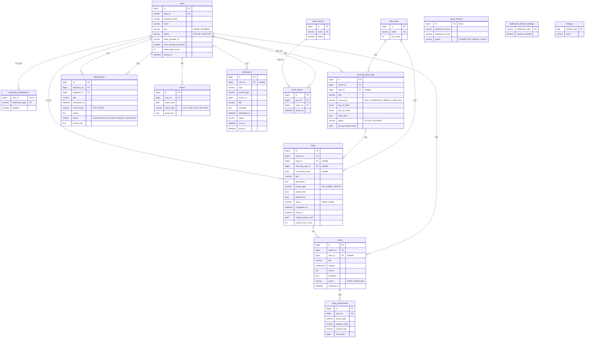
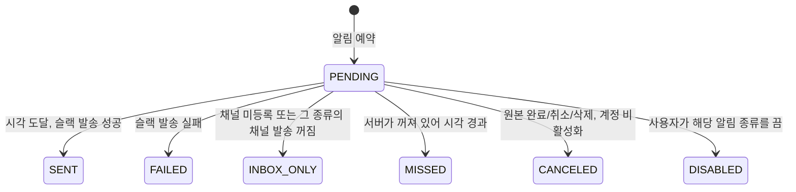

# ERD (초안 v0.3)

> 기준 문서: [PRD.md](PRD.md), [permissions.md](permissions.md), [features/](../features/)
> DB: MySQL 8 · 문자셋 `utf8mb4` · 접근: Spring Data JPA
> v0.3 변경: 단일 팀으로 단순화. `teams`, `team_memberships`, `audit_logs`, 모든 `team_id`와 `visibility` 컬럼 제거.

## 1. 전체 다이어그램



## 2. 공통 규칙

| 항목 | 규칙 |
|---|---|
| PK | `BIGINT AUTO_INCREMENT` |
| 공통 컬럼 | 모든 테이블에 `created_at`, `updated_at` (`DATETIME(6)`, JPA Auditing) |
| 시각 | `DATETIME(6)`, **UTC로 저장**. 화면 표시와 스케줄 계산은 `Asia/Seoul` |
| 날짜 | 기간, 연차, 공휴일처럼 "그날"을 뜻하는 값은 `DATE` (한국 날짜 기준) |
| Enum | `VARCHAR` + JPA `@Enumerated(EnumType.STRING)`. MySQL `ENUM` 타입은 쓰지 않음(값 추가 시 DDL 필요) |
| 삭제 | 사용자는 **삭제하지 않고 비활성화**. 업무 데이터는 실제 삭제 |
| 마이그레이션 | Flyway (`backend/src/main/resources/db/migration`) |

## 3. 핵심 설계 결정

### 3.1 관리자는 DB 제약으로 1명을 보장한다

`users`에 생성 컬럼을 하나 두고 UNIQUE를 걸면, MySQL에서 관리자가 2명이 되는 것을 DB가 막아줍니다.

```sql
admin_marker TINYINT GENERATED ALWAYS AS (CASE WHEN role = 'ADMIN' THEN 1 END) STORED,
UNIQUE KEY uk_users_single_admin (admin_marker)
```

- 팀원은 `NULL`이라 UNIQUE에 걸리지 않고, 관리자만 `1`이 되어 1명으로 제한됩니다.
- 위임은 한 트랜잭션에서 **기존 관리자를 먼저 `MEMBER`로 바꾼 뒤** 새 관리자를 `ADMIN`으로 바꿉니다(순서가 바뀌면 UNIQUE 위반).

### 3.2 알림은 한 테이블이 "발송 예약"과 "알림함"을 겸한다

TODO, 배포, 연차, 주간 통계가 알림이 필요하면 `notifications`에 `PENDING` 행을 만들고, 스케줄러는 이 테이블만 봅니다. 새 기능이 생겨도 스케줄러를 고칠 필요가 없어요.



- `source_type` + `source_id`: 알림의 원본(예: `TODO`, 42). 알림함에서 원본으로 이동할 때 사용. 다형 참조라 FK는 없습니다.
- `UNIQUE (source_type, source_id, type, scheduled_at)`: 같은 알림이 두 번 예약되는 것을 막습니다.
- **놓친 알림 판단**: 서버가 켜질 때와 매 분 스케줄러가 `PENDING AND scheduled_at < now - 5분`인 행을 `MISSED`로 바꿉니다.
- 수신자에게 `slack_member_id`가 있으면 메시지에 `<@멤버ID>` 멘션을 붙이고, 없으면 `[이름]`을 붙입니다.
- `user_id`가 `NULL`인 행은 **팀 메시지**(예: 팀 합계 주간 통계)입니다. 채널로만 보내고 개인 알림함에는 보이지 않습니다.
- **알림함**에는 본인의 `PENDING`, `CANCELED`, `DISABLED`를 제외한 행이 보입니다.
- 알림은 생성 후 **90일이 지나면 배치로 삭제**합니다.

### 3.3 TODO의 기간

- `period_type` + `period_start`로 기간을 정하고, 조회를 쉽게 하려고 `period_end`도 함께 저장합니다.
  - `DAY`: start = end = 그날
  - `WEEK`: 월요일 ~ 일요일
  - `MONTH`: 1일 ~ 말일
- **지연** = `status = OPEN AND period_end < 오늘` (저장하지 않고 계산)
- **이월**하면 기간을 새로 정하고, 처음 이월할 때만 `original_period_start`에 원래 시작일을 기록하며, `carried_over_count`를 1 올립니다.
- 반복 TODO로 생성된 TODO는 `recurring_rule_id`와 **바뀌지 않는 발생일 `occurrence_date`**를 가지고, `UNIQUE (recurring_rule_id, occurrence_date)`로 **같은 날 두 번 생성되는 것을 막습니다**(서버 재시작, 소급 생성 시 안전). `period_start`로 막지 않는 이유는, 어제 것을 오늘로 이월하면 오늘 생성될 TODO와 `period_start`가 겹치기 때문입니다.
- 반복 규칙을 중지/삭제해도 이미 생성된 TODO는 남습니다(`ON DELETE SET NULL`).

### 3.4 단일 행 설정 테이블

슬랙 채널은 서비스 전체에 하나뿐이므로 `slack_channel`은 `id = 1`인 행만 가집니다(`CHECK (id = 1)`). 행이 없으면 슬랙 미사용입니다.

## 4. 테이블 상세

### 4.1 계정

**users**

| 컬럼 | 타입 | 제약 | 설명 |
|---|---|---|---|
| id | BIGINT | PK | |
| login_id | VARCHAR(50) | NOT NULL, UK | 로그인 아이디 |
| password_hash | VARCHAR(100) | NOT NULL | BCrypt |
| name | VARCHAR(50) | NOT NULL | 표시 이름 |
| role | VARCHAR(10) | NOT NULL | `ADMIN`, `MEMBER` |
| admin_marker | TINYINT | 생성 컬럼, UK | 3.1 참고. 관리자 1명 보장 |
| status | VARCHAR(10) | NOT NULL | `ACTIVE`, `INACTIVE`. 관리자는 `INACTIVE` 불가(서비스 검증) |
| slack_member_id | VARCHAR(20) | NULL | 채널 메시지 @멘션용 (예: `U01AB2CD3`). 본인이 등록 |
| must_change_password | BOOLEAN | NOT NULL, 기본 true | 첫 로그인/초기화 후 true |
| failed_login_count | INT | NOT NULL, 기본 0 | 성공 시 0으로 초기화 |
| locked_at | DATETIME(6) | NULL | 5회 실패 시 기록. 관리자가 해제 |

### 4.2 알림 설정

**slack_channel** (0~1행)

| 컬럼 | 타입 | 제약 | 설명 |
|---|---|---|---|
| id | TINYINT | PK, CHECK (id = 1) | |
| webhook_url_enc | VARCHAR(500) | NOT NULL | AES-GCM 암호화. 키는 환경변수 |
| webhook_url_hint | VARCHAR(30) | NOT NULL | 화면 표시용 `https://hooks.slack.com/…/abcd` |
| status | VARCHAR(20) | NOT NULL | `CONNECTED`, `NEEDS_CHECK` |
| verified_at | DATETIME(6) | NULL | 마지막 테스트 발송 성공 시각 |
| registered_by | BIGINT | FK → users | |

**notification_channel_settings** (관리자가 관리)

| 컬럼 | 타입 | 제약 | 설명 |
|---|---|---|---|
| notification_type | VARCHAR(40) | PK | `TODO_REMINDER`, `DEPLOY_REMINDER`, `DEPLOY_ASSIGNED`, `LEAVE_NOTICE`, `TEAM_WEEKLY_SUMMARY` 등 |
| channel_enabled | BOOLEAN | NOT NULL | 행이 없으면 켜진 것으로 간주 |

**notification_preferences** (사용자 본인이 관리)

| 컬럼 | 타입 | 제약 | 설명 |
|---|---|---|---|
| user_id | BIGINT | PK, FK → users | |
| notification_type | VARCHAR(40) | PK | |
| enabled | BOOLEAN | NOT NULL | 행이 없으면 켜진 것으로 간주 |

### 4.3 TODO

**todo_types**

| 컬럼 | 타입 | 제약 | 설명 |
|---|---|---|---|
| id | BIGINT | PK | |
| name | VARCHAR(30) | NOT NULL, UK | |
| sort_order | INT | NOT NULL, 기본 0 | |

- 삭제하면 `todos.type_id`, `recurring_todo_rules.type_id`는 `ON DELETE SET NULL`(유형 "없음").

**todos**

| 컬럼 | 타입 | 제약 | 설명 |
|---|---|---|---|
| id | BIGINT | PK | |
| owner_id | BIGINT | NOT NULL, FK → users | 작성자 = 수행자 |
| type_id | BIGINT | NULL, FK → todo_types | |
| recurring_rule_id | BIGINT | NULL, FK → recurring_todo_rules | ON DELETE SET NULL |
| occurrence_date | DATE | NULL | 반복 규칙이 생성한 날짜. 이월해도 바뀌지 않음 |
| title | VARCHAR(200) | NOT NULL | |
| description | TEXT | NULL | |
| period_type | VARCHAR(10) | NOT NULL | `DAY`, `WEEK`, `MONTH` |
| period_start | DATE | NOT NULL | |
| period_end | DATE | NOT NULL | |
| status | VARCHAR(10) | NOT NULL | `OPEN`, `DONE` |
| completed_at | DATETIME(6) | NULL | 완료 취소 시 NULL |
| notify_at | DATETIME(6) | NULL | TODO당 알림 1개 |
| original_period_start | DATE | NULL | 처음 이월될 때의 원래 기간 시작일 |
| carried_over_count | INT | NOT NULL, 기본 0 | 이월 횟수 |
| | | UK (recurring_rule_id, occurrence_date) | 반복 생성 중복 방지 (둘 다 NULL인 일반 TODO는 제외됨) |
| | | IDX (owner_id, period_start) | 내 할 일 |
| | | IDX (period_start) | 팀 할 일, 통계 |

**recurring_todo_rules**

| 컬럼 | 타입 | 제약 | 설명 |
|---|---|---|---|
| id | BIGINT | PK | |
| owner_id | BIGINT | NOT NULL, FK → users | |
| type_id | BIGINT | NULL, FK → todo_types | |
| title | VARCHAR(200) | NOT NULL | |
| recurrence | VARCHAR(10) | NOT NULL | `DAILY`, `WEEKDAYS`, `WEEKLY`, `MONTHLY` |
| day_of_week | TINYINT | NULL | `WEEKLY`일 때 1(월)~7(일) |
| day_of_month | TINYINT | NULL | `MONTHLY`일 때 1~31. 그 달에 없는 날이면 말일 |
| notify_time | TIME | NULL | 생성된 TODO의 `notify_at` = 그날 + 이 시각 |
| status | VARCHAR(10) | NOT NULL | `ACTIVE`, `STOPPED` |
| last_generated_date | DATE | NULL | 소급 생성 기준. 최대 7일까지 소급 |

- 생성되는 TODO의 `period_type`은 `DAY`입니다(반복 TODO는 그날의 할 일).
- `WEEKDAYS`는 주말과 `holidays`를 건너뜁니다.
- 규칙을 수정하면 이후 생성분부터 반영됩니다.

### 4.4 이슈

**issues**

| 컬럼 | 타입 | 제약 | 설명 |
|---|---|---|---|
| id | BIGINT | PK | |
| author_id | BIGINT | NOT NULL, FK → users | |
| todo_id | BIGINT | NULL, FK → todos | ON DELETE SET NULL (TODO 삭제 시 독립 이슈로 남음) |
| title | VARCHAR(200) | NOT NULL | |
| content | MEDIUMTEXT | NULL | 마크다운 |
| cause | TEXT | NULL | 원인 |
| resolution | TEXT | NULL | 해결 방법 |
| status | VARCHAR(10) | NOT NULL | `OPEN`, `RESOLVED` |
| resolved_at | DATETIME(6) | NULL | |
| | | IDX (todo_id) | |
| | | FULLTEXT (title, content) `WITH PARSER ngram` | 한국어 키워드 검색 |

**issue_attachments**

| 컬럼 | 타입 | 제약 | 설명 |
|---|---|---|---|
| id | BIGINT | PK | |
| issue_id | BIGINT | FK → issues, ON DELETE CASCADE | |
| stored_path | VARCHAR(300) | NOT NULL | 로컬 디스크 경로(UUID 파일명). 배포 시 오브젝트 스토리지로 교체 가능 |
| original_name | VARCHAR(255) | NOT NULL | |
| content_type | VARCHAR(50) | NOT NULL | 이미지 타입만 허용 |
| size_bytes | BIGINT | NOT NULL | 최대 10MB |

### 4.5 배포 / 연차

**deployments**

| 컬럼 | 타입 | 제약 | 설명 |
|---|---|---|---|
| id | BIGINT | PK | |
| registrant_id | BIGINT | NOT NULL, FK → users | |
| assignee_id | BIGINT | NOT NULL, FK → users | 활성 사용자만 지정 가능(서비스 검증) |
| title | VARCHAR(200) | NOT NULL | |
| scheduled_at | DATETIME(6) | NOT NULL | 알림은 1시간 전 |
| environment | VARCHAR(10) | NOT NULL | `DEV`, `PROD` |
| memo | TEXT | NULL | |
| status | VARCHAR(10) | NOT NULL | `SCHEDULED`, `SUCCESS`, `FAILED`, `CANCELED` |
| result_note | TEXT | NULL | |
| completed_at | DATETIME(6) | NULL | 결과 기록 시각 |
| | | IDX (scheduled_at) | 배포 캘린더 |

**leaves**

| 컬럼 | 타입 | 제약 | 설명 |
|---|---|---|---|
| id | BIGINT | PK | |
| user_id | BIGINT | NOT NULL, FK → users | |
| leave_date | DATE | NOT NULL | 하루에 한 행 |
| leave_type | VARCHAR(10) | NOT NULL | `FULL`, `AM_HALF`, `PM_HALF` |
| group_key | CHAR(36) | NOT NULL | 여러 날을 한 번에 등록한 묶음(UUID). 묶음 단위 삭제용 |
| | | UK (user_id, leave_date) | 같은 날 중복 등록 방지 |
| | | IDX (leave_date) | 팀 캘린더, 오늘 부재 |

- 기간으로 등록하면 주말과 공휴일은 행을 만들지 않습니다.

**holidays**

| 컬럼 | 타입 | 제약 | 설명 |
|---|---|---|---|
| holiday_date | DATE | PK | |
| name | VARCHAR(50) | NOT NULL | 관리자가 연 1회 입력 |

### 4.6 알림

**notifications**

| 컬럼 | 타입 | 제약 | 설명 |
|---|---|---|---|
| id | BIGINT | PK | |
| user_id | BIGINT | NULL, FK → users | 대상자. `NULL`이면 팀 메시지 |
| type | VARCHAR(40) | NOT NULL | `notification_channel_settings`와 같은 값 |
| source_type | VARCHAR(20) | NULL | `TODO`, `DEPLOYMENT`, `LEAVE`, `SUMMARY` 등 |
| source_id | BIGINT | NULL | |
| title | VARCHAR(200) | NOT NULL | 발송 직전에 원본으로 갱신 |
| message | TEXT | NULL | |
| scheduled_at | DATETIME(6) | NOT NULL | |
| status | VARCHAR(20) | NOT NULL | 3.2의 상태 |
| sent_at | DATETIME(6) | NULL | |
| read_at | DATETIME(6) | NULL | 알림함에서 읽은 시각 |
| failure_reason | VARCHAR(300) | NULL | |
| | | UK (source_type, source_id, type, scheduled_at) | 중복 예약 방지 |
| | | IDX (status, scheduled_at) | 스케줄러 |
| | | IDX (user_id, created_at) | 알림함 |

### 4.7 점심 룰렛

**lunch_menus**

| 컬럼 | 타입 | 제약 | 설명 |
|---|---|---|---|
| id | BIGINT | PK | |
| name | VARCHAR(50) | NOT NULL, UK | |
| active | BOOLEAN | NOT NULL, 기본 true | 삭제 대신 비활성(추첨 이력 보존) |

**lunch_draws**

| 컬럼 | 타입 | 제약 | 설명 |
|---|---|---|---|
| id | BIGINT | PK | |
| user_id | BIGINT | NOT NULL, FK → users | |
| menu_id | BIGINT | FK → lunch_menus | |
| drawn_at | DATETIME(6) | NOT NULL | "최근 2주 제외"에 사용 |

## 5. 저장하지 않는 것

| 항목 | 이유 |
|---|---|
| 주간/월간 통계 | `todos`, `issues`, `leaves`에서 조회 시 계산. 데이터가 많아지면 그때 집계 테이블 추가 |
| 지연 여부 | `status`와 `period_end`로 계산 |
| 작성자 비활성 표시 | `users.status`로 계산 |
